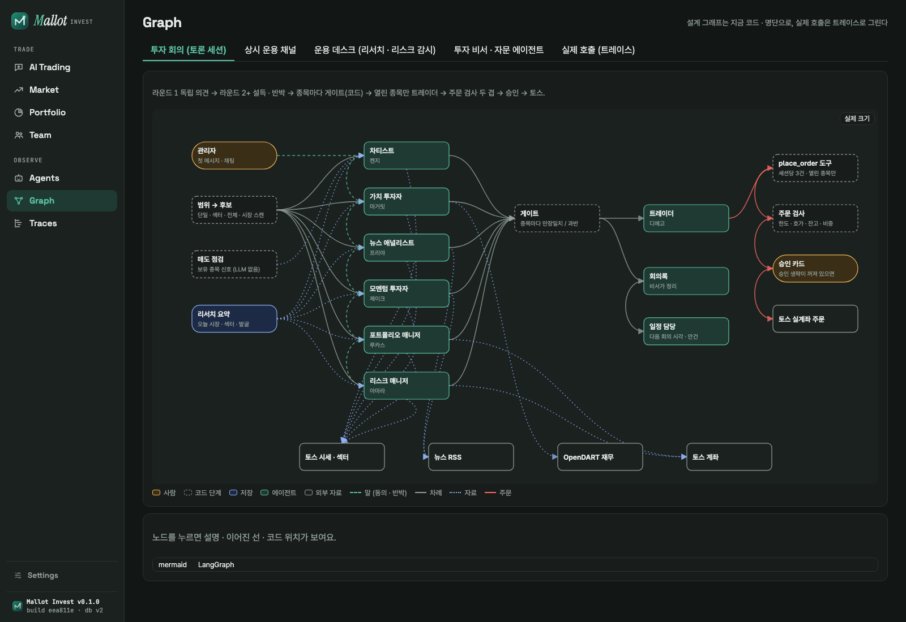
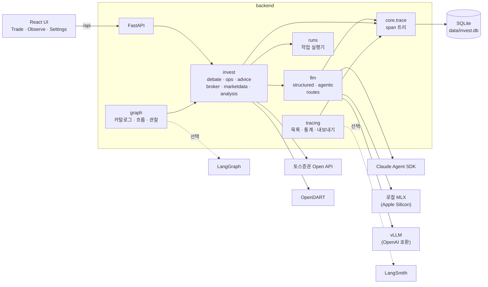
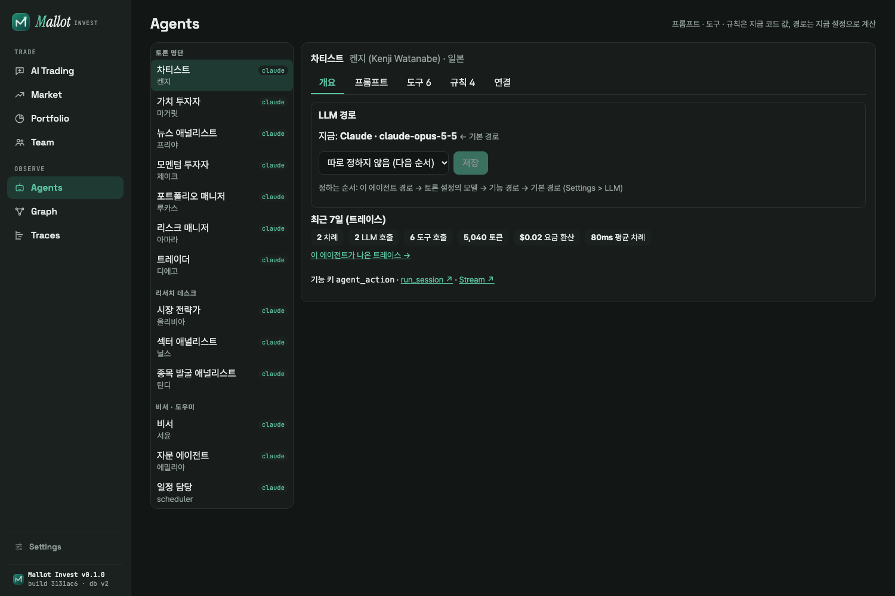
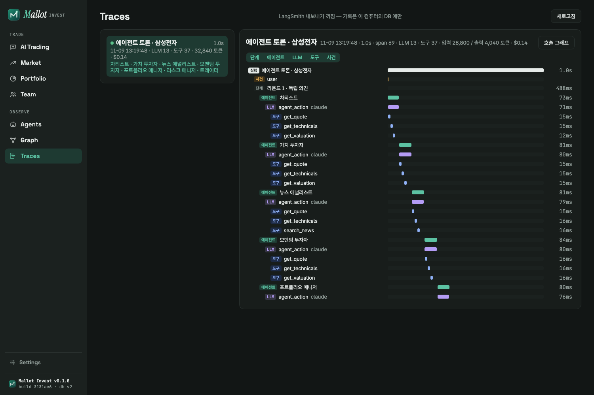
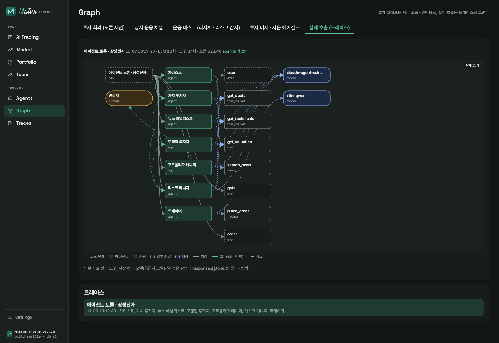

# Mallot Invest Agent

여러 LLM 에이전트가 시장을 분석하고 토론한 뒤, **코드가 정한 게이트를 통과한 종목만** 트레이더 에이전트가 주문하는 멀티 에이전트 투자 데스크.
개인 자산관리 앱 Mallot 의 투자 기능만 떼어 내 독립 실행되게 정리했다.

- **LLM 라우팅** — 에이전트 · 기능마다 Claude Agent SDK / 로컬 MLX / vLLM(OpenAI 호환) 중 골라 보낸다
- **에이전트 설정 보기** — 에이전트마다 시스템 프롬프트 · 도구 · 규칙 · LLM 경로 · 연결을 지금 코드 값 그대로
- **구조 그래프 · 호출 추적** — LangSmith 처럼 실행 → 라운드 → 에이전트 → LLM → 도구 트리를 남기고 그린다 (LangSmith · LangGraph 로 내보내기 선택)



> ⚠️ 주문은 **토스증권 실계좌**로 나간다 (모의 투자 없음). 키가 없으면 샘플 시세로만 동작하고 주문은 막힌다.
> 투자 조언이 아니며, 에이전트 토론이 수익을 높인다고 주장하지 않는다 — 판단 근거를 펼쳐 보는 실험이다.

## 무엇을 하나

| 흐름 | 내용 |
|---|---|
| 투자 회의 | 분석 에이전트 6명(차티스트 · 가치 · 뉴스 · 모멘텀 · 포트폴리오 · 리스크)이 라운드 1 독립 의견 → 라운드 2+ 설득 · 반박. 코드가 종목마다 게이트(만장일치 / 과반)를 따지고, 열린 종목만 트레이더가 주문 → 주문 검사 두 겹 → 관리자 승인 → 토스 |
| 상시 운용 | 정기 회의 없이 장 내내 계기(관리자 말 · 리스크 경보 · 급변 · 매도 신호)마다 3명이 말하고, 입장판 + 의견 가중치(지난 판단 성과)로 게이트를 연다. 서버가 재시작돼도 채널을 다시 열고, 중지했거나 오류로 거듭 끊기면 자동 운용 서랍의 **재개**로 다시 연다 |
| 운용 데스크 | 장 전 시장 전략가 → 섹터 애널리스트 → 종목 발굴 애널리스트, 장 중 10분마다 리스크 감시(코드) |
| 투자 비서 · 자문 | 채팅으로 운용 지시 · 회의 일정 · 운용 목표를 정리하고 다른 에이전트에게 묻는다 (주문 도구 없음) |
| 판단 재료 | 토스 시세 · 기술 지표, OpenDART 재무로 가치평가(PER · PBR · ROE · S-RIM), 뉴스 RSS — 숫자는 모두 코드, LLM 은 판단과 이유만 |
| 거래 기록 | 앱이 낸 주문 + 토스 계좌의 지난 체결(앱 밖 · 앱을 쓰기 전 거래도 그때 체결가로). 체결된 매수 · 매도마다 거래 금액 · 지금 금액 · 손익(매도는 주문 때 적어 둔 토스 평단으로 실현 손익), 행을 펼치면 그 주문을 낳은 토론 — 안건 · 입장판 무게 · 에이전트 의견 · 트레이더 판단 |

## 구조



자세한 모듈 지도는 [docs/architecture.md](docs/architecture.md), LangGraph · LangSmith 연계는 [docs/langgraph.md](docs/langgraph.md).

```text
backend/            Python 3.12 · uv · FastAPI
  app/core/         DB · 마이그레이션 · .env · 공인 주소 HTTP · 호출 추적(trace)
  app/llm/          structured · agentic, 경로(routes), Claude SDK · MLX(local) · vLLM, 공용 루프(loop)
  app/runs/         작업 실행기 (토론 · 리서치 · 리포트가 실행 하나로)
  app/invest/       broker · marketdata · analysis (바닥) / debate · ops · advice (에이전트) / api*.py
  app/graph/        에이전트 카탈로그 · 흐름 그래프 · 관찰 그래프 · LangGraph 내보내기
  app/tracing/      트레이스 API · LangSmith 내보내기
  app/auth/         관리자 로그인 · 손님 공유 링크 · 요청마다 역할 검사(guard)
  app/share/        휴대폰용 운용 현황 요약 데이터
  tests/            pytest (가짜 토스 계좌 · 가짜 LLM — 실제 주문 · LLM 호출 없음)
frontend/           React 19 · Vite · TypeScript
  src/features/invest/    AI Trading · Market · Portfolio · Trades(거래 기록) · Team
  src/features/observe/   Agents · Graph · Traces
  src/features/settings/  투자 키 · 한도, LLM (MLX · 경로 · vLLM), 공유 · 접근
  src/features/auth/      관리자 로그인
  src/features/share/     운용 현황 요약 (현황 · 보고서 · 회의, 휴대폰 탭)
docs/               architecture.md · langgraph.md · share.md · images/
scripts/            dev · serve · share · tunnel-setup · test · check-secrets
```

## 빠른 시작

필요한 것: [uv](https://docs.astral.sh/uv/), Node.js 22, (Claude 를 쓰면) [Claude Code](https://code.claude.com/docs) 로그인 또는 `ANTHROPIC_API_KEY`.

```bash
make install            # 백엔드(uv) · 프론트(npm) 의존성 + 커밋 전 비밀값 검사 훅
cp .env.example .env    # 키를 채운다 (.env 는 git 에서 제외)
make dev                # 백엔드 :8100 + 프론트 :3100 → http://localhost:3100
make serve              # 프론트를 빌드해 백엔드 하나로 → http://localhost:8100
make share              # 로그인 필수로 띄우고 Cloudflare 터널로 인터넷에 (docs/share.md)
make test               # 비밀값 검사 + pytest + oxlint · tsc · vite build
```

선택 설치: `cd backend && uv sync --extra langsmith --extra langgraph`.

| `.env` | 용도 |
|---|---|
| `TOSS_CLIENT_ID` · `TOSS_CLIENT_SECRET` · `TOSS_ACCOUNT_SEQ` | 토스증권 Open API (없으면 샘플 시세) — 허용 IP 등록 필요 |
| `MIA_TRADING_PIN` | 주문 PIN (4자리 이상). 화면 · API 로 못 바꾼다 |
| `MIA_AUTOPILOT` | 자동 운용 켜기(1) · 끄기(0). 켜면 승인 없이 실계좌 주문 — 서버를 다시 켜지 않아도 따른다 |
| `MIA_ADMIN_PASSWORD_HASH` | 관리자 비밀번호 해시 (`make admin-password` 가 넣는다). 인터넷에 열 때 필수 — [docs/share.md](docs/share.md) |
| `DART_API_KEY` | OpenDART 재무 (가치평가, 선택) |
| `ANTHROPIC_API_KEY` · `MIA_LLM_MODEL` | Claude (비우면 Claude Code 로그인) |
| `MIA_VLLM_URL` · `MIA_VLLM_API_KEY` | vLLM 서버 (예: `http://127.0.0.1:8001/v1`) |
| `MIA_MODELS_DIR` | 이미 받은 MLX 모델 폴더를 같이 쓸 때 |
| `LANGSMITH_API_KEY` + `MIA_LANGSMITH_EXPORT=1` | LangSmith 로 트레이스 내보내기 (둘 다 있어야) |

## LLM 라우팅

호출 하나가 어디로 갈지는 아래 순서로 정한다 ([app/llm/routes.py](backend/app/llm/routes.py)).

1. 이미지가 든 프롬프트 → Claude
2. **에이전트 경로** — 지금 말하는 에이전트에 정해 둔 경로 (Agents 화면에서 에이전트마다)
3. 부르는 쪽이 넘긴 모델 — 토론 설정의 모델
4. **기능 경로** — `agent_action` · `invest_assistant` · `invest_desk` · `news_report` …
5. **기본 경로** — 비면 Settings > LLM 의 기본 LLM (Claude / 로컬)

경로 글자: `claude` · `claude-sonnet-5-5` · `mlx` · `vllm` · `vllm:Qwen/Qwen3-32B`.

| 공급자 | 구조화 출력 | 도구 | 비고 |
|---|---|---|---|
| Claude Agent SDK | 서버가 JSON Schema 강제 | 앱 도구만 (SDK MCP), Claude Code 기본 도구 · 다른 MCP 끔 | 구독 로그인이면 요금은 API 단가 환산 |
| 로컬 MLX | 스키마를 프롬프트에 + 검사 · 다시 받기 | 채팅 템플릿 도구 호출 | Apple Silicon, 작업 프로세스(127.0.0.1 + 토큰), KV 캐시 예산 |
| vLLM | `response_format` json_schema + 검사 | OpenAI `tool_calls` | 서버를 `--enable-auto-tool-choice --tool-call-parser <파서>` 로 |

MLX 와 vLLM 은 같은 루프([app/llm/loop.py](backend/app/llm/loop.py))를 쓰고 백엔드만 다르다. 모든 호출은 `llm_usage` 에 사용량(토큰 · 요금 · 지연)을, `trace_spans` 에 span 을 남긴다.

## 에이전트 설정 보기 · 그래프 · 추적 (Observe)

| Agents | Traces |
|---|---|
|  |  |

- **Agents**
  - 에이전트마다 시스템 프롬프트(예시 세션으로 그린 실제 모양) · 도구(설명 · 입력 스키마 · 자료 출처 · 읽기/쓰기) · 규칙(코드 줄 링크) · 연결(말하는 상대 · 듣는 곳)
  - **LLM 경로와 그 경로가 어디서 정해졌는지** — 여기서 바로 바꾼다
- **Graph**
  - 투자 회의 · 상시 운용 · 운용 데스크 · 비서 흐름의 설계 그래프 + mermaid + LangGraph 컴파일 결과
  - **실제 호출** 탭: 트레이스 하나에서 누가 무엇을 몇 번 불렀고 누가 누구에게 동의 · 반박했는지

  
- **Traces**
  - 실행 → 단계 → 에이전트 → LLM → 도구 · 사건 span 트리와 워터폴
  - span 마다 프롬프트 · 출력 · 경로 · 토큰 · 요금
  - 기록은 이 컴퓨터의 SQLite 에만 남는다. LangSmith 로는 직접 켰을 때만 보낸다

## 안전

- **모든 주문이 한 곳(`trading.place_order`)을 지난다.** 순서대로 검사한다:
  1. 전체 중지
  2. 주문 조건 (토스 키 · PIN)
  3. 국내 종목인지
  4. 정수 수량 · 호가 단위
  5. 건당 한도 · 하루 한도
  6. 매수 가능 금액 / 판매 가능 수량
  7. 매수 후 종목 비중
- **에이전트 주문은 기본으로 관리자 승인을 기다린다.** 자동 운용을 켜면(`.env` 의 `MIA_AUTOPILOT=1`) 승인 없이 낸다. 그래도 위 검사는 그대로다.
  - 켜기 · 끄기는 PIN 을 묻지 않는다. 화면 버튼도 같은 줄을 고치고, 파일을 손으로 고쳐도 20초 안에 따른다.
  - 회의 시각 · 운용 방식 · 운용 지시 · 지금 판단은 주문 PIN 을 묻는다.
- **관리자 비밀번호를 정하기 전에는 이 컴퓨터용이다.**
  - `make serve` 는 기본으로 `127.0.0.1` 에만 연다. 같은 와이파이의 다른 기기에서 열려면 `HOST=0.0.0.0` 을 주되, 믿는 네트워크에서만 연다.
  - 터널 · 프록시를 거쳐 온 요청은 비밀번호가 없으면 서버가 막는다.
  - 인터넷 · 휴대폰에서 쓰려면 `make admin-password` → `make share` ([docs/share.md](docs/share.md)). 관리자는 비밀번호로 로그인하고, 손님은 공유 링크로 같은 화면을 읽기만 한다 (설정 · 주문 · 대화를 못 바꾸고, 키 · 공유 설정은 못 본다).
- **Mallot 과 같은 토스 키로 동시에 띄우지 않는다.**
  - 토스 토큰은 키당 하나라서, 다시 발급받으면 이전 토큰이 끊긴다.
  - 두 앱에서 자동 운용을 켜면 주문이 두 번 나갈 수 있다.
- **LLM 경로 설정은 PIN 없이 바꾼다** (Mallot 의 기본 LLM 설정과 같다). vLLM 주소는 `.env` 로만 정할 수 있다.

## 공개 저장소에서 개인 정보 지키기

- `.gitignore`: `data/`(DB · 실행 산출물 · 모델), `.env*`, 키 파일, DB 파일
- `scripts/check-secrets.sh`: 커밋 훅(`make hooks`)과 CI 에서 DB · `.env` · 키 모양 값이 섞이면 막는다
- 테스트는 가짜 토스 계좌(`tests/fake_broker.py`)와 가짜 LLM 으로 돈다 — 실제 주문 · LLM 호출 없음
- 프로필 그림은 원래 Mallot 처럼 포켓몬 공식 일러스트를 PokeAPI 공개 스프라이트 주소에서 그때그때 불러온다. 저장소에는 그림 파일이 없고 전국도감 번호만 있다. 불러오지 못하면(오프라인 등) 직접 그린 SVG 캐릭터로 바꿔 보여 준다

## 개발

- 작업 하나 = 브랜치 하나(`feat/…` · `fix/…` · `docs/…`) → 작은 커밋 → PR → CI(비밀값 · pytest · 프론트 빌드) 통과 → 머지
- 커밋은 [Conventional Commits](https://www.conventionalcommits.org/)
- 구조 규칙은 [tests/test_architecture.py](backend/tests/test_architecture.py) 가 잠근다:
  - 공용 계층(core · llm · runs)은 기능을 부르지 않는다
  - 투자 바닥 계층(broker · marketdata · analysis)은 에이전트 계층(debate · ops · advice)을 부르지 않는다
