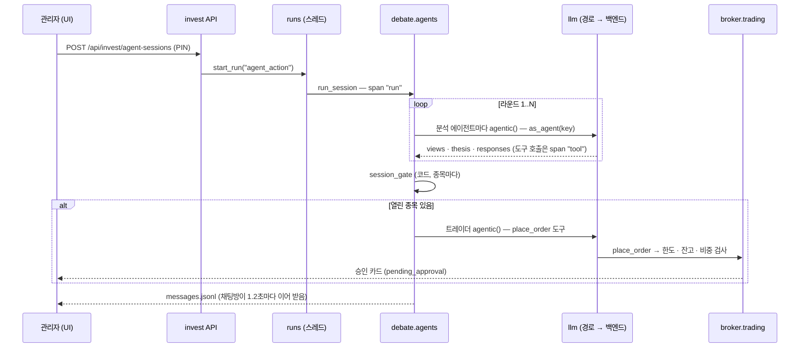

# 구조

## 계층

```text
core  ←  llm  ←  runs  ←  invest (broker · marketdata · analysis  ←  debate · ops · advice)  ←  graph · tracing
```

- 화살표는 "불러 쓴다"의 반대 방향이다 (왼쪽이 아래 계층).
- [tests/test_architecture.py](../backend/tests/test_architecture.py) 가 이 방향을 검사한다.
- 함수 안에서 늦게 부르는 import 는 허용한다 (순환을 끊는 용도).

| 패키지 | 하는 일 |
|---|---|
| `app/core` | SQLite 연결 · 스키마 단계(`migrations.py`, `PRAGMA user_version`) · `.env` 로더 · 공인 주소만 여는 HTTP · **호출 추적 기록**(`trace.py`) |
| `app/llm` | `structured()`(도구 없음) · `agentic()`(앱 도구만) 단일 진입점, 경로(`routes.py`), 백엔드: Claude Agent SDK · 로컬 MLX(`local.py` · `mlx_worker.py`) · vLLM(`vllm.py`), 채팅 루프(`loop.py`), 사용량 `llm_usage` |
| `app/runs` | 작업 실행기 — 상태 · 진행률 · 로그 · 지표 · 산출물(`data/runs/<id>`). 실행을 새로 만드는 범용 API 는 없다 (토론은 PIN 을 거치는 투자 API 로만) |
| `app/invest/broker` | 토스증권 Open API(`toss.py`), 주문 한도 · PIN(`config.py`), **모든 주문이 지나는** `trading.place_order`, 내 투자현황(`portfolio.py`) |
| `app/invest/marketdata` | 시세 제공자(토스 / 샘플), 기술 지표, 뉴스 RSS, 관심 그룹 |
| `app/invest/analysis` | 코드가 계산하는 판단 재료 — OpenDART 재무 · 가치평가, 시장 스캔 점수, 판단 기록, 보유 종목 매도 점검, 운용 목표 |
| `app/invest/debate` | 토론 엔진(`agents.py`: 명단 · 도구 · 라운드 · 게이트 · 트레이더), 상시 운용 채널(`stream.py`), 의견 가중치(`track.py`), 회의록, 토론 범위 |
| `app/invest/ops` | 자동 운용 일정(`autopilot.py`), 운용 데스크(`desk.py` · `desk_agents.py`), 아침 브리핑 · 보고서, 뉴스 리포트 |
| `app/invest/advice` | 투자 비서(`assistant.py`), 자문 에이전트(`advisor.py`) |
| `app/invest/api*.py` · `jobs/` · `service.py` | 라우터 · 작업(agent_action · desk_research · news_report) · 20초마다 일정 확인 스레드 |
| `app/graph` | 에이전트 카탈로그(`catalog.py`), 흐름 그래프(`topology.py`), 관찰 그래프(`observed.py`), LangGraph 내보내기 |
| `app/tracing` | 트레이스 목록 · 상세 · 에이전트별 통계 API, LangSmith 내보내기(`langsmith.py`, `service.py`) |
| `app/auth` | 관리자 비밀번호(scrypt) · 서명 쿠키 · 손님 공유 키(`security.py`), 요청마다 역할을 검사하는 미들웨어(`guard.py`), 비밀번호 정하기(`passwd.py`) — [share.md](share.md) |
| `app/share` | 손님 화면 데이터(`views.py`) — 자동 운용 상태 · 오늘 리서치 · 보고서 · 회의 대화를 읽기만, 운용 지시 글 · 설정은 빼고 |

새 기능 패키지는 `app/<이름>/` 에 `api.py`(라우터) · `jobs/`(작업) · `service.py`(start/stop) 를 두면 `app/registry.py` 가 자동으로 붙인다.

## 토론 한 판의 흐름



## 호출 추적 데이터

`trace_spans` 한 줄 = span 하나 (스키마 v2).

| 열 | 뜻 |
|---|---|
| `trace_id` · `parent_id` | 트리 (맨 위 span 의 id 가 trace_id) |
| `kind` | `run` · `step`(라운드 · 대화) · `agent` · `llm` · `tool` · `event`(게이트 · 주문 · 관리자 말) |
| `agent` | 이 span 을 일으킨 에이전트 키 (부모에게서 물려받음) |
| `input_json` · `output_json` | 프롬프트 · 결과 (20,000자에서 자름) |
| `attrs_json` | LLM: 경로 · 어디서 정해졌나 · 공급자 · 모델 · 토큰 · 요금 · 턴, 도구: 읽기 전용 여부 |

- 시작할 때 `running` 으로 한 줄을 쓰고, 끝날 때 고친다. 그래서 진행 중인 토론도 화면에서 보인다.
- 서버를 시작할 때 30일 지난 span 을 지운다.

## API

| 접두사 | 내용 |
|---|---|
| `/api/invest/*` | 시세 · 종목 · 주문 · 계좌 · 포트폴리오 · 관심 · 뉴스 · 리포트 · 에이전트 세션 · 자동 운용 · 운용 데스크 · 비서 · 운용 목표 · 판단 기록 · 가치평가 |
| `/api/runs` | 실행 목록 · 상세 · 로그 · 지표 · 취소 · 삭제 |
| `/api/llm` | 기본 LLM · 로컬 MLX 모델 · 경로(`/routes`, `/routes/resolve`) · vLLM(`/vllm`) |
| `/api/graph` | 에이전트 카탈로그 · 흐름 · 관찰 그래프 · LangGraph 내보내기 |
| `/api/traces` | 트레이스 목록 · 상세 · 에이전트별 통계 · LangSmith 상태 |
| `/api/auth` | 내 역할 · 관리자 로그인 · 로그아웃 · 손님 입장 · 공유 링크 켜기 · 끄기 · 새 키 |
| `/api/share` | 손님 화면 — 운용 상태 · 지금 보고서 · 지난 보고서 · 회의 목록 · 회의 대화 (손님 · 관리자) |
| `/api/health` | 살아 있는지 · DB 스키마 버전 |

로그인이 켜져 있으면(관리자 비밀번호가 있거나 `MIA_PUBLIC=1`) `/api/share/*` 는 손님 · 관리자, 로그인 · 입장 · 상태 확인은 누구나, 나머지는 관리자만 연다 (`app/auth/guard.py`).

서버를 띄운 뒤 `http://localhost:8100/docs` 에서 전체 OpenAPI 를 볼 수 있다.
